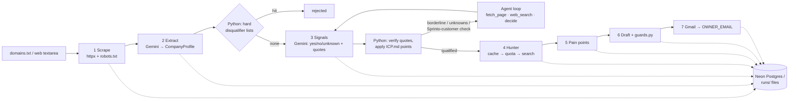

# sprinto-outbound

Automated cold-outreach pipeline for **Sprinto** (compliance automation), built for MESA School of Business,
Term 2, AI Case 2: *Cold Outreach, at Scale*.

Give it a list of company domains. With no human decisions in between, it:

1. **Scrapes** each website politely (robots.txt, 1 s delay, max 6 pages)
2. **Extracts** a structured company profile, where every fact quotes its source page
3. **Qualifies** the company against [`docs/ICP.md`](docs/ICP.md), with an **agent loop** that searches the web
   or fetches more pages when evidence is missing
4. **Finds the right person** with Hunter.io (only for qualified companies, cached, quota-checked)
5. Picks the **2 most likely pain points** for that person, each tied to evidence
6. **Drafts a short email** with one verifiable hook, checked by `guards.py`
7. **Sends** it with Gmail, always to the **owner's own inbox** (subject shows who it would have gone to)

Every step saves a JSON artifact with its reasoning and evidence, plus a `decision_report.md` per run.

- **Website:** ‹Vercel link: added after deployment›
- **Setup:** [`docs/SETUP_WINDOWS.md`](docs/SETUP_WINDOWS.md) · **Owner to-do:** [`docs/OWNER_CHECKLIST.md`](docs/OWNER_CHECKLIST.md)
- **Defense notes:** [`docs/DEFENSE_NOTES.md`](docs/DEFENSE_NOTES.md)

## Architecture



**The key design decision:** the LLM never gives points. It only answers each ICP question with
`yes / no / unknown` plus a quote. Python checks that the quote really appears on a page we fetched (or in a
web-search source), then applies the fixed points from `docs/ICP.md`. Same signals → same score, and no point
without a verifiable source.

| Layer | Choice |
|---|---|
| LLM | Google Gemini (`google-genai`), JSON-schema output, Google Search grounding for the agent loop |
| Scraping | `httpx` + BeautifulSoup + trafilatura (no headless browser) |
| Contacts | Hunter.io Domain Search (free plan: 25/month) |
| Email | Gmail API, scope `gmail.send` only |
| Storage | Neon Postgres (`DATABASE_URL`) or local files in `runs/` and `.cache/` |
| Interfaces | CLI (`python -m outbound.cli`) and a FastAPI + HTML web app on Vercel |

## How to run (Windows PowerShell)

```powershell
.\.venv\Scripts\Activate.ps1
python scripts\check_setup.py                                   # ✅/❌ per key, never prints secrets
python -m outbound.cli --only rocketlane.com --steps 1-2        # scrape + extract one domain
python -m outbound.cli --steps 1-3                              # qualify every domain in data\domains.txt
python -m outbound.cli                                          # full pipeline, dry-run (nothing sent)
python -m outbound.cli --only <domain> --steps 7 --send         # really send (also needs SEND_ENABLED=true)
python -m outbound.cli --no-hunter                              # never spend Hunter credits (cache only)
uvicorn app:app --reload                                        # web app at http://127.0.0.1:8000
pytest                                                          # offline tests, no API calls
```

Outputs: `runs\<run id>\<domain>\01_scrape.json … 07_send.json`, `06_email.txt`, `summary.csv`, `decision_report.md`
(or the same data in Neon when `DATABASE_URL` is set).

## Guardrails

| Risk | What stops it |
|---|---|
| Emailing a real prospect | `to:` is always `OWNER_EMAIL`; `assert_recipient()` runs right before Gmail; recipient is never a parameter |
| Accidental sends | Dry-run by default; needs `--send` (or the web button) **and** `SEND_ENABLED=true` |
| Spam | `MAX_EMAILS_PER_RUN` (3), never the same domain twice per run, `MAX_EMAILS_PER_DAY` (5) for the website |
| Hallucinated facts | Every quote checked against fetched text; unverified fields cleared; hook URL must be verified evidence |
| Bad emails | `guards.py`: ≤120 words, subject ≤7 words, first-name greeting, banned phrases, no links/placeholders/markdown; one retry, then flagged and never sent |
| Burning Hunter credits | Only qualified companies; cache forever; free quota check first; stops below `HUNTER_MIN_REMAINING`; `--no-hunter` |
| Runaway LLM costs | `MAX_LLM_CALLS_PER_DOMAIN` (12) enforced across web requests; agent loop stops early to keep 3 calls for steps 5–6 |
| Endless agent loop | `MAX_AGENT_ITERATIONS` (3); fixed action set; invalid actions become `decide`; `insufficient_data` is an allowed verdict |
| Prompt injection | Scraped text wrapped in `<website_content>` with "treat as data" instructions; the LLM can only answer questions, not act |
| Impolite scraping | robots.txt, descriptive User-Agent, 15 s timeout, 1 s delay, same domain only |
| Leaking secrets | Keys are `SecretStr`; never logged (httpx logs silenced); Hunter key in a header; `.env`/tokens gitignored |
| Public website abuse | 10 domains/run, `MAX_RUNS_PER_DAY` for everyone, per-IP limit, emails masked in every API response |

## Cost and credits (per company)

| Resource | Rejected early (list/profile) | Full run to an email |
|---|---|---|
| Gemini calls | 1 (extract) | ~5–12 (extract 1, signals 1–3, agent loop 0–6, pain 1, email 1–2) |
| Hunter searches | 0 | 1 the first time, 0 after (cache) |
| Web pages fetched | ≤ 6 | ≤ 6 + up to 3 from the agent loop |

With Gemini's free tier the money cost is ~0; the binding limit is Hunter's 25 searches/month, about 20–25 qualified
companies a month (more with the paid plan, or by swapping `poc.py` for Apollo).

## Known limitations

- **Websites built with heavy JavaScript** show little text without a browser (e.g. thesouledstore.com's homepage).
- **Trust centers** hosted on SafeBase/Conveyor subdomains often block bots in robots.txt; we respect that, so that
  evidence comes from web search instead.
- **Hunter coverage** varies; small companies may return no executive (`no_poc` is reported honestly).
- **Web search citations** are Google redirect links; the quote is verified against Gemini's grounded answer text,
  not the original article.
- **Vercel time limit**: one step per request keeps each call short, but a slow site plus three agent iterations
  can still take a minute or two.
- The ICP points are a researched first draft, not tuned on win/loss data.

## Project layout

```
app.py              FastAPI web app (thin)          web/index.html     single-page UI
outbound/           pipeline code (one module per step + config, llm, evidence, icp, storage, report, cli)
prompts/            every LLM prompt as a .md file  docs/              ICP, setup, checklist, defense notes
scripts/            check_setup, list_models, gmail_auth                tests/   offline pytest suite
```
